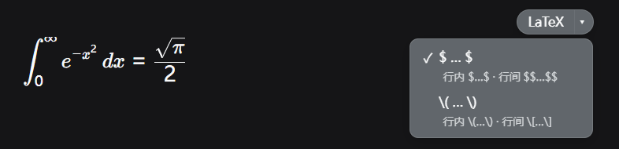

# dsh-latexcp

DeepSeek Harness (DSH) Web 界面公式与表格复制插件：悬停 KaTeX 公式浮现按钮，一键复制公式的 TeX 源码；悬停 Markdown 表格，一键把整张表复制成 GFM 表格文本。



## Overview

DSH 用 KaTeX 渲染公式，渲染结果只适合看，不适合直接复制：框选粘贴得到的是排版碎片。但 KaTeX 在页面 DOM 里保留了每个公式的原始 TeX 源码（隐藏的 `.katex-mathml` 子树中的 `<annotation encoding="application/x-tex">` 节点）。这个插件悬停任意公式时在右上角浮现一个小按钮：

- 点主按钮 `LaTeX`：把该公式的源码复制到剪贴板；
- 点箭头 `▾`：展开格式菜单，两种输出格式二选一设为默认：

| 格式 | 行内公式 | 行间（块级）公式 |
| --- | --- | --- |
| 美元符号 | `$E=mc^2$` | `$$E=mc^2$$` |
| 斜杠括号 | `\(E=mc^2\)` | `\[E=mc^2\]` |

插件自动识别公式是行内还是行间（KaTeX 行间公式外层带 `.katex-display` 标记），按你选的格式输出正确的单/双定界符，不用自己改。

如果你经常要把对话里的公式搬进论文、笔记或别的 Markdown 文档，会用到它。

### Markdown 表格复制

悬停对话里的 Markdown 表格时，同一位置的按钮变成 `Markdown`，点一下把整张表（表头 + 全部数据行）复制成 GFM 表格文本：

- 列对齐还原成 `:---` / `:---:` / `---:`（源表没声明对齐的列用 `---`）；
- 单元格内的粗体、斜体、删除线、行内代码、链接、图片、`<br>` 按 Markdown 语法回写，行内公式按当前默认格式输出；
- 单元格里的竖线自动转义成 `\|`，换行压成空格（GFM 单元格不能跨行）。

```text
| 姓名 | 备注 |
| :--- | :---: |
| 张三 | a\|b 与 `x` |
```

只对 Markdown 渲染器产出的表格生效（有 `<thead>` 表头行）；其他 `<table>`（比如文档预览里的表格）不会触发按钮。


## Compatibility

在 `@deepseek-ai/dsh` **0.2.0-rc.2**（npm `latest`）上验证通过，最后验证日期 2026-10-14。上一轮记录是 0.1.0-rc.6（npx 部署快照）：升到 0.2.0-rc.2 本身不需要改代码，0.1.1 起把样式表的归属标记对齐了官方写法（见下表末行）。

核对过的依赖点（对照 0.2.0-rc.2 的 `dsh-client-modules`、`dsh-package-manifest`、`dsh-client-ui-primitives` 源码，并用 `dsh --profile web --dump-config` 确认组合里有 `ui-latexcp` 行、无 `skippedBundles` 告警）：

| 依赖点 | 0.2.0-rc.2 现状 |
| --- | --- |
| 客户端模块格式 | `window.__ModuleLoader__.load({ id, factory })` 未变，官方 `dsh-client-ui-*` 插件同一写法 |
| `dsh.client` 声明 | `platform`（必填）、`inject`、`external`、`immediately`；本插件只用 `platform: "web"` + `inject: []` |
| bundle 挂载通道 | `dsh.bundle.patch` 仍有效，`cordis.patch.yml` 的 `insert` 出 `ui-latexcp` 行 |
| KaTeX 渲染 DOM | 仍是 `katex.renderToString` 的默认 `htmlAndMathml` 输出，`.katex-mathml` 的 `annotation[encoding="application/x-tex"]` 与 `.katex-display` 都在 |
| Markdown 表格 DOM | 渲染器产出 `<div class="_tableScroll_…"><table><thead><tr><th>…`，表格必有 `<thead>` 首行；列对齐只在源表声明对齐时写成 th/td 的内联 `text-align`（left/center/right），没声明就没有该样式 |
| 主题 token | `--dsw-alias-border-l1/l2`、`--dsw-alias-bg-overlay`、`--dsw-alias-bg-layer-1`、`--dsw-alias-label-primary/secondary`、`--dsw-alias-state-success-primary` 都在 |
| 插件样式归属 | 官方约定是 `<style data-plugin="<包名>" data-plugin-css="<包名>/<文件名>">`，宿主 `removeOwnedStyles(id)` 按插件 id 兜底回收；本插件自 0.1.1 起按此写法注入 |

插件依赖 KaTeX 渲染 DOM 的两个结构：`.katex-mathml` 里的 `annotation[encoding="application/x-tex"]` 节点（源码保留处）和 `.katex-display` class（行间公式标记）。表格复制依赖 `<table>` 自带 `<thead>` + `<th>` 这一条（用来排除文档预览等非 Markdown 表格），不认 CSS module 的哈希 class（`_tableScroll_xxx_192` 随时会变），所以 DSH 改版只要还输出标准 `<thead>` 表格就不受影响。DSH 大版本如果调整 Markdown/KaTeX 渲染 DOM，可能需要跟着改。

纯浏览器端插件，没有宿主半部，没有服务注入。复制走浏览器 `navigator.clipboard`（用户点击触发）。

### DSH 版本闸门

0.2.0-rc.2 起，profile 导入插件前会拿插件 `peerDependencies` 里 `@deepseek-ai/dsh` 与 `@deepseek-ai/dsh-*` 的声明比运行时版本，对不上的 bundle 会被跳过并记进 `skippedBundles`（跳过，不是启动失败）。豁免写在 profile 的 `compatibility.json`，用 `dsh plugin allow-version` 按「精确包名@版本 + 精确 DSH 版本」授予，插件升级或 DSH 升级都不会继承。

本插件只声明了 `@deepseek-ai/cordis`（不在闸门检查的命名空间里），因此闸门对它不做约束，DSH 升级不会让插件静默消失。这是刻意的：本插件真正依赖的是 KaTeX 渲染 DOM 的内部结构，`peerDependencies` 的版本区间表达不了这种依赖，写窄了只会在 DSH 升版时把插件整块摘掉。`engines.dsh` 字段 DSH 不读，写了也不生效。

## Install

装进官方 web profile（自带 dsh-base + dsh-web-app 两层）：

```powershell
dsh plugin --profile web add github:chi-hong22/dsh-latexcp
# 或本地 checkout：
dsh plugin --profile web add D:/path/to/dsh-latexcp
```

仓库包含构建产物（`lib/` 已提交，纯 JS 没有构建步骤），安装后无需另外构建。`dsh plugin add` 会写入依赖并把本包加进 profile 的 bundles 列表，挂载行来自本包自带的 `cordis.patch.yml`，不需要手动改任何 profile 文件。

验证安装：

```powershell
dsh --profile web --dump-config | Select-String ui-latexcp
```

输出里有下面几行就是装上了：

```yaml
# == @chi-hong22/dsh-latexcp
- id: ui-latexcp
  name: '@chi-hong22/dsh-latexcp'
```

重启 DSH，插件出现在 设置 → 插件 里。

手动安装只留给旧版本或调试：把本包作为 workspace/link 依赖装上，再在 profile 的 `cordis.patch.yml` 里手写一行 `insert: [{ id: ui-latexcp, name: '@chi-hong22/dsh-latexcp' }]`。别和 bundle 通道并用，同一行挂两次会双重加载。

## Uninstall

```powershell
dsh plugin --profile web remove @chi-hong22/dsh-latexcp
```

执行后重启 DSH 生效。

如果你当时是手动安装的（旧路径）：删掉 profile `cordis.patch.yml` 里的 `ui-latexcp` 行、`package.json` 里的依赖、`node_modules` 里的链接，然后重启。

插件不写磁盘，删掉就是删干净了。升级：`link:` 安装的直接更新仓库目录内容，重启生效；npm 安装的用 `dsh plugin --profile web add @chi-hong22/dsh-latexcp@<version>`。

## Quick start

没有插件级配置项。

```text
1. 悬停任意公式        # 右上角浮现「LaTeX ▾」按钮（移开后约 0.25 秒消失）
2. 点 LaTeX            # 按当前默认格式复制源码，按钮短暂显示「✓ 已复制」
3. 点 ▾                # 展开格式菜单：$ … $ / \( … \)（带行内/行间小字说明）
4. 点其中一项          # 设为默认格式（✓ 标记），再点 LaTeX 即按新格式复制
5. 悬停 Markdown 表格  # 按钮变成「Markdown」，点一下复制整张 GFM 表格
```

初始默认格式是美元符号 `$…$`。行内/行间自动对应：行内公式得单定界符，行间公式得双定界符，两种格式都是。

## Configuration

没有配置项，也没有环境变量。行为常量在 `lib/client.js` 顶部：

- 输出格式：美元 `$…$`（行内）/ `$$…$$`（行间）；斜杠 `\(…\)`（行内）/ `\[…\]`（行间）；
- 表格复制的单元格行内公式也按上面选定的格式输出（没有单独的表格格式开关）；
- `HIDE_GRACE_MS = 250`：鼠标移出公式后按钮保留的宽限期（毫秒），方便把鼠标移上按钮；
- `RESTORE_LABEL_MS = 1200`：「✓ 已复制」文案恢复为 `LaTeX` 的时间（复制后按钮保持显示，可连续再复制或切换格式）；
- `FOLLOW_MS = 100`：按钮跟随公式位置的刷新间隔（流式渲染/滚动时位置不漂移）；
- 初始默认格式：`dollar`（改 `currentFormat = FORMATS[0]` 的初始值可换）。

默认格式只存在浏览器内存里（插件运行期），不做持久化：停用、更新或重启后回到初始默认格式。

## Permissions & data

不碰文件、网络、凭据和用户数据；没有宿主半部，不上传也不存储任何内容。只读当前页面公式 DOM 里的 TeX 源码（`annotation` 节点文本，仅浏览器内存内），只在用户点击按钮时写剪贴板。不修改消息内容之外的任何 DOM。所有副作用（按钮、样式、监听器、定时器）都挂在 Cordis fiber 上，插件停用即还原。

## Troubleshooting

| 现象 | 排查 |
| --- | --- |
| 悬停公式没有按钮 | 确认插件已挂载（`dump-config` 看 `ui-latexcp` 行）；公式必须是已渲染完成的 KaTeX 公式（流式输出中的纯文本阶段没有按钮）；打开浏览器控制台看 `dsh-latexcp` 相关报错 |
| 悬停表格没有按钮 | 只认 Markdown 渲染器产出的表格（带 `<thead>` 表头行）；文档预览、Excel 预览等其他 `<table>` 不触发。代码块里的表格源码也不会触发 |
| 复制出的表格出现 `\|` | 单元格原文就含竖线，为保持 GFM 合法自动转义；粘进支持 GFM 的编辑器会正常渲染成竖线 |
| 点复制显示「复制失败」 | 浏览器剪贴板权限（`navigator.clipboard` 需要 secure context 或已授权）；localhost 页面正常，其他场景看控制台 |
| 粘贴出来的定界符不对 | 确认选的是想要的格式；行内/行间由公式类型决定，块级公式会得到双定界符 |
| 按钮颜色与主题不搭 | 按钮走 DSH 主题 token（`--dsw-alias-*`），切换明暗主题即跟随；个别 token 缺失时回退中性配色 |

日志：插件不写日志文件；运行期错误在浏览器开发者工具 Console 里。

## Development

没有构建步骤：直接改 `lib/client.js`（浏览器半部）和 `lib/index.js`（宿主半部空实现），重启 DSH 生效。

```
├── package.json       # 包声明（dsh.bundle.patch + dsh.client；peerDeps 仅 cordis）
├── cordis.patch.yml   # bundle patch：insert ui-latexcp 行（官方挂载通道）
├── LICENSE
└── lib
    ├── index.js     # 宿主半部（空实现，纯 UI 插件的 Loader 约定）
    └── client.js    # 浏览器半部（__ModuleLoader__ 模块格式）
```

手动验证清单：悬停浮现按钮、移开宽限期、复制（美元/斜杠两种格式）、行内/行间定界符对应、菜单切换默认格式、「✓ 已复制」后连续再复制、停用插件后按钮与样式全部还原；表格侧：悬停表格标签变 `Markdown` 且箭头隐藏、复制结果含对齐标记与转义竖线、单元格内公式跟随当前格式、宽表按钮不超出可见区、从表格移到公式再移回标签正确切换。

纯函数回归验证（Node，不需要浏览器）：

```powershell
node .scratch/latexcp/verify.mjs
```

浏览器端回归（需要 Edge，PowerShell）：

```powershell
Start-Process "C:\Program Files (x86)\Microsoft\Edge\Application\msedge.exe" -ArgumentList @("--headless=new","--disable-gpu","--no-first-run","--remote-debugging-port=9333","--user-data-dir=$env:TEMP\edge-cdp-profile","about:blank")
node .scratch/cdp-run.mjs ("file:///" + (Resolve-Path .scratch\table-demo.html).Path.Replace('\','/')) 9333
```

发布到 npm 时，把 `name` 换成你自己有权控制的 scope，不要占用 `@deepseek-ai/*` 官方保留命名空间；`repository` 字段已填。

## License & security

许可证：MIT（见 LICENSE）。

安全问题走 GitHub Issue；涉及未公开细节的不要写进公开 issue，先通过仓库所有者的 GitHub 主页私信联系。
